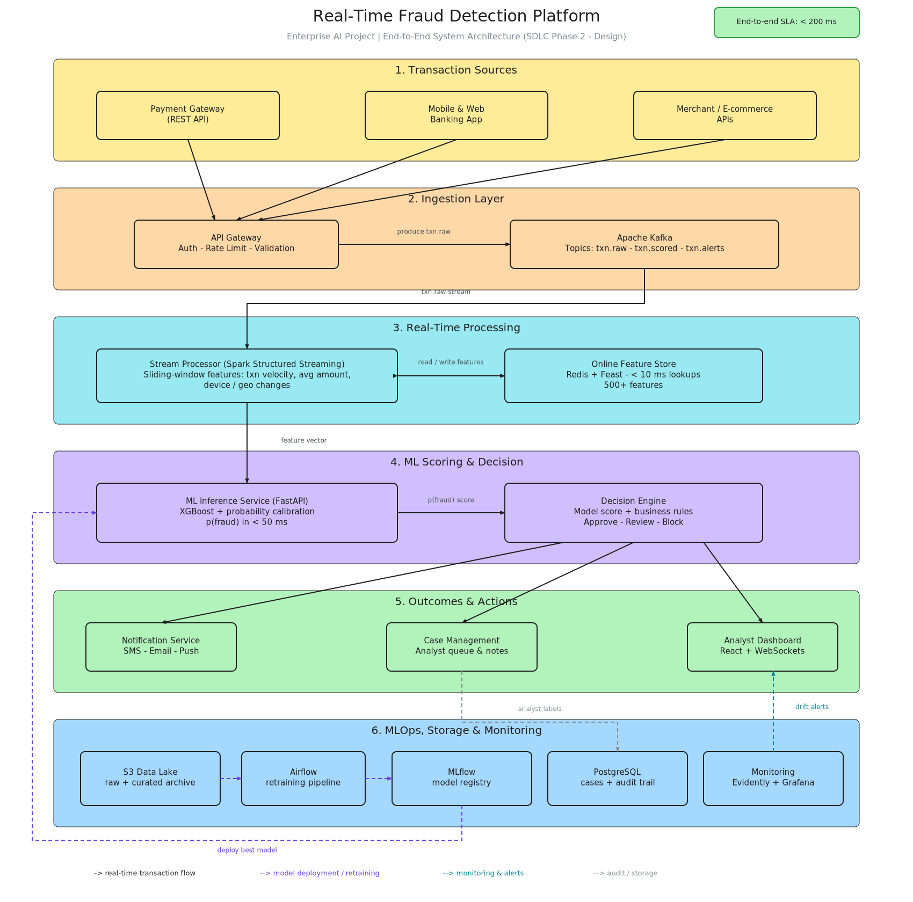

# 🛡️ Real-Time Fraud Detection Platform

**Enterprise AI Engineer project** — an end-to-end, production-style streaming ML platform that scores payment transactions in real time, catches fraud with an ML model + business rules, routes suspicious cases to human analysts, and closes the loop with automated retraining.

> **Stack is 100% free & open-source.** No paid cloud services anywhere.



---

## 1. Problem Statement

A payments company processes thousands of transactions per day. Rule-only systems catch only known fraud patterns, false positives block genuine customers, and fraudsters adapt faster than static rules update. The business needs:

- **sub-200ms risk scoring** on every transaction
- **sliding-window behavioural features** (card velocity, device change, merchant change…)
- **a decision layer** combining model scores with business rules (approve / review / block)
- **human-in-the-loop** case management that feeds analyst verdicts back as training labels
- **continuous retraining** as fraud evolves

## 2. Free / Open-Source Stack

| Concern | Technology | Why |
|---|---|---|
| Streaming bus | **Apache Kafka 3.9** (KRaft, no ZooKeeper) | industry-standard event backbone |
| Stream processing | **Python consumer + Redis sliding windows** | laptop-friendly; swappable with Spark/Flink |
| Online feature store | **Redis 7** (ZSET windows) | <10ms lookups, free |
| Offline store / warehouse | **PostgreSQL 16** | cases, scored txns, audit trail |
| Model | **XGBoost** + scikit-learn metrics | fraud-ML workhorse |
| Model registry / tracking | **MLflow 2.17** | versioning + stage promotion (Production) |
| Inference API | **FastAPI + Uvicorn** | async, typed, production-grade |
| Dashboard | **Streamlit** | analyst UI in pure Python |
| Containerization | **Docker Compose** | one-command full platform |
| Orchestration (optional) | **Airflow DAG** provided | retraining automation |
| Testing | **pytest** (100-test all-side QA suite) | SDLC Phase 4 |

## 3. System Architecture

Six layers (see `docs/architecture.png`, editable source `docs/architecture.excalidraw`):

1. **Transaction Sources** — payment gateway REST API, mobile/web banking, merchant APIs
2. **Ingestion** — API Gateway → Kafka topics `txn.raw`, `txn.scored`, `txn.alerts` (+ `txn.labels`, `txn.dlq`)
3. **Real-Time Processing** — stream processor computes sliding-window features via the Redis feature store
4. **ML Scoring & Decision** — FastAPI inference service (XGBoost) → decision engine (thresholds + velocity rule)
5. **Outcomes & Actions** — notifications, case management (PostgreSQL), analyst dashboard
6. **MLOps Loop** — MLflow registry → model deployment; Airflow/cron retraining; drift monitoring (Evidently) on the roadmap

**Data flow:** every transaction is scored from *prior-only* features, scored+decision written to `txn.scored`, non-approve decisions raise alerts and open a case. Analyst verdicts become fresh labels for retraining.

## 4. Project Structure (SDLC-aligned)

```
fraud-detection-platform/
├── docker-compose.yml          # Phase 5 - Deployment (Kafka, Redis, Postgres, MLflow, services)
├── Dockerfile
├── db/init.sql                 # Data layer - warehouse schema
├── src/
│   ├── common/                 # contracts: config, pydantic schemas, FEATURE SET (single source of truth)
│   ├── datagen/                # Phase 1 - Data: synth generator, Kaggle loader, Kafka replay producer
│   ├── training/               # Phase 3 - Model: offline features, XGBoost training, MLflow registry
│   ├── streaming/              # Phase 3 - Pipeline: online feature store, stream processor
│   ├── inference/              # Phase 3 - Serving: FastAPI + decision engine + case API
│   └── dashboard/              # Streamlit analyst UI
├── airflow_dags/retrain_dag.py # Phase 6 - Monitoring/MLOps (optional Airflow)
├── scripts/retrain.sh          # cron-friendly retraining job
├── qa/                         # Phase 4 - DEFECT_LOG.md (5 defects, all closed)
├── tests/                      # Phase 4 - 100 tests in 9 suites (see QA report)
└── docs/                       # architecture diagram (png + excalidraw source)
```

## 5. Quickstart (10 minutes)

Prereqs: **Docker Desktop** + Python 3.11+.

Generated transaction data and model files are intentionally excluded from
Git. Generate a local training dataset and model before starting the services:

```powershell
python -m pip install -r requirements.txt
python -m src.datagen.synth_generator --rows 20000 --out data/processed/demo_transactions.csv
python -m src.training.train --csv data/processed/demo_transactions.csv --no-mlflow
Copy-Item .env.example .env
```

Before starting Docker, edit `.env` and replace the example
`POSTGRES_PASSWORD` with a random hex password. Keep `.env` private; it is
excluded from Git. If reusing an existing PostgreSQL volume, use the password
that was set when that volume was first initialized.

```powershell
# Build service-specific images one at a time. This avoids downloading the
# full training/test dependency set into every container.
docker compose build inference
docker compose build stream-processor
docker compose build dashboard
docker compose build producer

# Start Kafka, Redis, Postgres, MLflow, inference, stream processor and dashboard.
docker compose up -d

# Check that the services are healthy.
docker compose ps

# Open the live transaction form and submit a NEW event:
#    Dashboard -> http://localhost:8502
#    API docs  -> http://localhost:8000/docs
# The dashboard submits to POST /v1/transactions. The event goes through
# Kafka -> Redis features -> model/API decision -> PostgreSQL -> dashboard.

# Optional: replay the pre-generated CSV into Kafka at 20 txn/sec.
docker compose --profile demo up -d producer

# Other observability pages:
#    Kafka UI -> http://localhost:8081
#    MLflow   -> http://localhost:5000
```

The Docker dashboard is published on host port `8502` so it can run alongside
a locally started Streamlit dashboard on `8501`. Kafka UI uses host port
`8081`, and PostgreSQL host port `5433`, to avoid existing local listeners;
containers still connect to `kafka:9092` and `postgres:5432` on the Compose
network.

The dashboard's manual transaction form is a live event source for end-to-end
testing; it is not connected to a bank or payment processor. To consume actual
payment events, integrate an authorized provider webhook/feed by mapping its
events to the `Transaction` schema and publishing them to `POST /v1/transactions`.
The model must be validated on representative, labeled data before decisions
are used to approve or block real payments.

Resolve a case through the API (closes the MLOps loop):

```bash
curl -X POST http://localhost:8000/v1/cases/1/verdict \
     -H 'Content-Type: application/json' -d '{"verdict": "FRAUD"}'
```

Run tests without any infra:

```bash
make test              # 100 tests: data, business, model, parity, e2e, SLA, security, resilience
pytest -m performance  # SLA suite only (run WITHOUT coverage tracer)
```

## 6. Engineering Decisions Worth Mentioning in Interviews 💬

- **Offline/online feature parity**: one shared `FEATURES` contract (`src/common/features.py`); offline windows use `closed='left'`, online store computes *before* writing the current event — the #1 fraud-ML production bug, designed out.
- **Late labels**: the producer streams transactions *without* labels and publishes them to `txn.labels` 30s later — mirrors real chargeback delays.
- **Fail-safes**: model-down → API returns 503 and the stream processor degrades to `REVIEW` instead of approving blindly; poison messages go to `txn.dlq` and never kill the pipeline.
- **Rules over raw scores**: a velocity rule (≥5 txns/10min) overrides the model — pure model scores are never trusted alone.
- **Time-based split** (70/15/15) — never random splits for temporal fraud data.
- **Class imbalance** handled with `scale_pos_weight`, evaluated with **PR-AUC** (not accuracy).

## 7. Measured Results (synthetic demo dataset, 20k txns, 3% fraud)

| Metric | Validation | Test |
|---|---|---|
| PR-AUC | 0.933 | **0.934** |
| ROC-AUC | 0.986 | **0.986** |
| Recall @ review threshold | 0.907 | **0.923** |
| Precision @ review threshold | 0.952 | **0.878** |

Live API smoke test (real model): velocity-burst night transaction → `p_fraud=1.00` **BLOCK**; everyday grocery POS transaction → `p_fraud=0.00` **APPROVE**.

## 8. Resume Bullets (copy-paste ready)

- Built an end-to-end **real-time fraud detection platform** (Kafka → Redis feature store → XGBoost → FastAPI → Streamlit) on a fully open-source stack, scoring transactions with sub-second latency and **0.93 test PR-AUC / 92% fraud recall**.
- Designed **offline/online feature parity** (sliding-window velocity, device & merchant change signals) with a single shared feature contract, eliminating train/serve skew.
- Implemented **human-in-the-loop MLOps**: case management with analyst verdicts persisted as labels, MLflow model registry with stage promotion, and automated retraining via Airflow/cron.
- Hardened the pipeline for production: dead-letter queue, model-down failover to rules-based review, late-arriving label handling, and a **100-test all-side QA suite** (business assumptions, model gates, feature parity, SLA, security, resilience) with **p99 = 30 ms vs the 200 ms SLA**.

### Phase 4 - QA & Testing (summary)

Full report: `QA_Test_Report_Fraud_Detection_Platform.docx` (repo root of the delivery package) + machine-readable evidence in `artifacts/qa/`.

- **100 / 100 tests pass in ~30 s** across 9 levels: data quality, unit, business assumptions (BA-01..BA-12 register), model gates, offline↔online parity, E2E, SLA, security, resilience.
- **5 real defects found and fixed** (2 were training/serving-skew bugs only parity testing could catch) - see `qa/DEFECT_LOG.md`.
- **Business assumptions verified on data**: night fraud 11.6% vs 1.9% day; device-change fraud 67% vs 2.5%; velocity bursts 100% fraud vs 3% base; legit auto-approval 99.66% (BA-06 budget ≥97%).
- **Model gates**: ROC-AUC 0.9858, PR-AUC 0.9342, recall@review 92.3%, block rate 2.6% - all inside release gates.
- **SLA**: p50 2.4 ms / p95 2.8 ms / p99 30.3 ms, 297 TPS single-thread (design target 200).

## 9. Roadmap (nice next iterations)

- [ ] Spark Structured Streaming / Flink job for horizontal scale (the consumer logic ports 1:1)
- [ ] SHAP explanations per decision (why was this blocked?)
- [ ] Evidently drift reports + Grafana/Prometheus monitoring profile
- [ ] Kafka exactly-once semantics & schema registry (Avro)
- [ ] A/B deployment of two model versions via MLflow aliases

## 10. SDLC Traceability

| SDLC Phase | Where in this repo |
|---|---|
| 1. Requirements | `docs/` problem statement (above) + SLA (<200ms, recall-first) |
| 2. Design | `docs/architecture.png` / `.excalidraw`, topic & schema contracts |
| 3. Development | `src/` (datagen, training, streaming, inference, dashboard) |
| 4. Testing | `tests/` - 100 passing tests, `qa/DEFECT_LOG.md`, QA report docx |
| 5. Deployment | `docker-compose.yml`, `Dockerfile`, `Makefile` |
| 6. Maintenance / MLOps | `airflow_dags/`, `scripts/retrain.sh`, MLflow registry, roadmap §9 |
